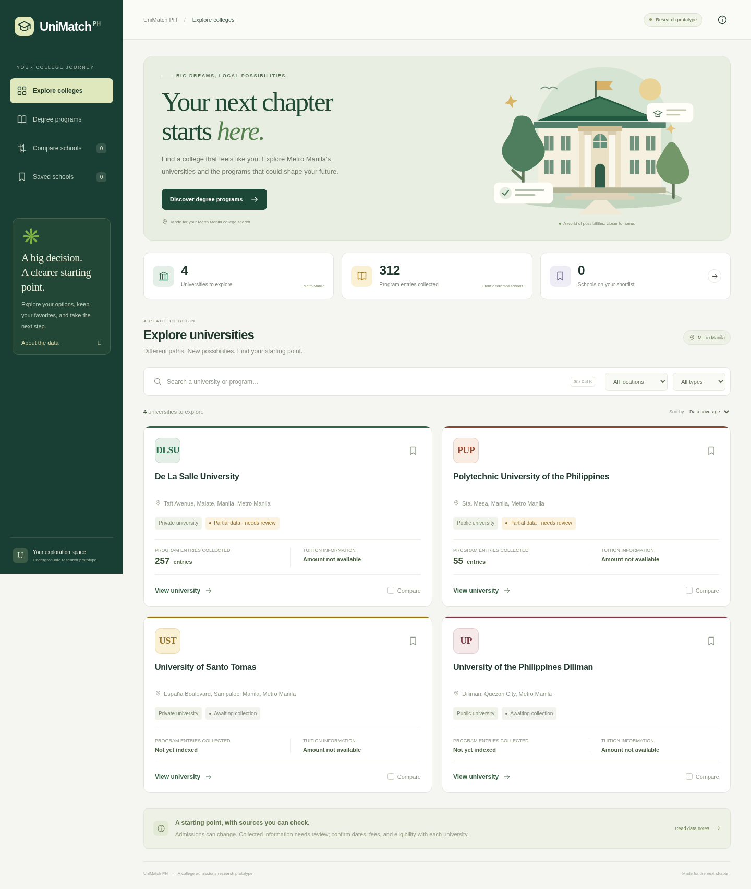

# UniMatch PH

A college admissions aggregator prototype for Manila city-proper, with a Python data
collector, Flask backend, SQLite database, and responsive website.

## Run the website on your laptop

Download and extract the latest repository ZIP, then open a terminal **inside the
folder containing `run_web.py`**. On CachyOS/Linux:

```bash
python -m venv .venv
.venv/bin/python -m pip install -r requirements-web.txt
.venv/bin/python run_web.py
```

Open the address printed by the server in your browser. Keep that terminal open;
press Ctrl+C to stop the website. No email, API key, Node.js installation, or live
university requests are needed to explore the prototype.

The home page is a server-rendered welcome page with the forest-green, sage and
cream visual identity, a campus illustration, and clear **Sign up** / **Log in**
actions. Successful authentication continues to the full explorer at `/explore`;
the welcome page also keeps a quiet “Explore the directory” link for visitors who
prefer to browse without an account. The full interactive explorer (saved schools,
comparison, degree programs and recommendations) is unchanged at `/explore`.

Every page has a light/dark switch in the header. The theme follows the operating
system preference on first visit, remembers an explicit choice in `localStorage`,
and applies before the first paint so there is no flash of the wrong theme.

The UniMatch mark (graduation cap over an open book, traced from
`icons/Untitled.jpg`) is a single themable vector: forest green on the cream
sidebar tile, gold on the dark welcome/account tile, and gold on the favicon.
The same `#i-logo` symbol is used everywhere, so the brand stays consistent.

The site includes university profiles, program search and topic filters, school
comparison, and a browser-stored shortlist kept separately for each account (and
for guests). Students can also register an
optional account, log in, save program/city/budget/university-type preferences, and
view personalised, explained recommendations. Public browsing remains available
without an account. A new database includes PUP's 55 program entries and the
user-supplied DLSU sample (257 indexed titles from 258 raw rows), for 312 searchable
entries. The directory lists 15 Manila schools; UP Manila replaces the earlier UP
Diliman placeholder, and UST plus the other newly added schools remain directory
entries awaiting collection. All admissions evidence remains marked for review;
fees and strand eligibility are not invented. Scholarships are excluded.

If you already used the earlier prototype, add the DLSU sample to your existing
database explicitly, then refresh the website:

```bash
.venv/bin/python -m flask --app webapp import-data data/dlsu/unimatch_ph_raw_data.json
```

Read the [DLSU dataset notes](data/dlsu/README.md): its source catalog includes
combined degrees, multiple campuses and some extraction artifacts. The fee
references contain no actual tuition amounts.



See the [website guide](webapp/README.md) for the backend architecture, API,
importing new scraper results, and testing. The original collector instructions
follow below.

## Implemented thesis algorithms

The three required algorithms are real modules shared by the collector and the
Flask application. They are not unused demonstrations.

| Algorithm | Module | Integrated use |
| --- | --- | --- |
| 1. Keyword-based NLP extraction and categorization | `algorithms/extraction.py` | Runs after every collection and during import/backfill; creates the structured profile |
| 2. Rule-based weighted matching | `algorithms/matching.py` | Backs `GET /api/recommendations` and the **Find my match** screen |
| 3. Hand-written stable merge sort | `algorithms/merge_sort.py` | Ranks every recommendation by descending score |

### Algorithm 1: extraction, normalization and reconciliation

`structure_record()` classifies text with keyword and regular-expression rules,
then normalizes academic years (`AY 2026-27` → `2026-2027`), complete English/ISO
dates, fee ranges, degree names, requirement statements, entrance-examination
names and official application links. It removes navigation/boilerplate, splits
numbered and prose requirement lists, deduplicates programs and fee rows, and
reconciles conflicting statements using source order (earlier approved page wins),
completeness and text length. Discarded values are kept in `data_conflicts` for
review. Missing values stay empty and are reported in `structured["missing"]`;
nothing is guessed or filled in.

### Algorithm 2: weighted rule-based matching

The implementation is `score_candidate()` and `recommend()` in
`algorithms/matching.py`. Only criteria the student actually supplies enter the
formula:

```text
score = 100 × Σ(weight[c] × points[c]) / Σ(weight[c])
```

Default weights are program 45%, location 20%, budget 20% and university type 15%.
They are normalized to 1 and can be changed in the interface or with the
`weights=program:0.5,location:0.2,...` API parameter. Each result includes a
criterion-by-criterion explanation and a `points` value. A criterion with missing
source data scores **0** and is marked `unknown`; it is never treated as a match.
Program matching is exact, all-keyword, partial-keyword, or no match. Budget
comparison uses only published numeric fees with the same basis (semester,
trimester, year or unit). Scholarships are outside scope.

### Algorithm 3: hand-written stable merge sort

`algorithms/merge_sort.py` implements a recursive top-down merge sort. It does not
call Python's `sorted()` or `list.sort()`. Equal keys keep their input order,
which makes tied recommendation scores deterministic. `merge_sort_by_score()`
sorts the scored candidates highest-first before the API returns them.

## Student accounts and security

Registration, login, logout, profile editing, saved preferences, password changes,
password resets and two-factor settings are server-rendered Flask routes:
`/register`, `/login`, `/login/2fa`, `/forgot-password`, `/reset-password/<token>`,
`/logout` and `/profile`. Browsing and the public read APIs remain unauthenticated.
The profile loads preferences for the user ID in the signed session and re-runs the
same Algorithm 2 + Algorithm 3 workflow used by `/api/recommendations`.

- **Passwords** are hashed with Werkzeug's `generate_password_hash` (scrypt) and
  verified with `check_password_hash`; plaintext passwords are never stored.
  Logged-in users can change a password after confirming the current one, and a
  forgotten password can be reset through a signed 30-minute, single-use link.
- **Two-factor authentication** is optional TOTP. The secret is encrypted at rest,
  enabling it requires a valid code, and ten recovery codes are stored only as
  hashes. A password change or reset signs out older sessions.
- **Profile PII** (email and display name) is encrypted at rest with AES-GCM from
  the maintained `cryptography` package. Email login uses a separate HMAC lookup
  hash, so the database does not need a plaintext email for authentication.
- **Public university data and preference values** stay unencrypted. Preferences
  are linked to the authenticated account and protected by server-side
  authorization, not by pretending encryption replaces access control.
- **Sessions** use `HttpOnly`, `SameSite=Lax`, `Secure` in production, an 8-hour
  lifetime, and a new session ID on login. State-changing forms require a CSRF
  token, and missing/invalid tokens are rejected with HTTP 400.
- **Transport** uses HTTPS enforcement and HSTS in production. HTTPS protects data
  in transit; it does not replace hashing, encryption at rest, or authorization.
- **Secrets** (`SECRET_KEY`, `UNIMATCH_DATA_KEY`, `UNIMATCH_LOOKUP_KEY`) come from
  the environment in production. Production startup fails if they are missing.
  Keys are never hardcoded or stored with the database. The
  [`rotate-data-key`](webapp/README.md#secrets) CLI re-encrypts profile PII; key
  backup and recovery procedures are documented in the website guide.

The prototype is not claimed to be completely secure. It has no email verification,
per-IP throttling, audit log, administrator console, WebAuthn/SMS second factor or
independent security review.

## Collection and structured data pipeline

Collection is triggered by a CLI command, not by website page loads:

```bash
# Required for live collection: a real research email or HTTPS project URL.
.venv/bin/python -m flask --app webapp collect-data \
  --contact "your-real-email@your-university.edu"

# Collect and summarize without writing to SQLite.
.venv/bin/python -m flask --app webapp collect-data --dry-run \
  --contact "your-real-email@your-university.edu"

# Re-run only when the configured interval has elapsed (for cron/systemd).
.venv/bin/python -m flask --app webapp collect-data --due \
  --contact "your-real-email@your-university.edu"

# Reproducible offline demonstration using the synthetic saved fixture.
.venv/bin/python -m flask --app webapp collect-data \
  --config config/demo_sources.json --fixture-dir fixtures/demo
```

`config/collection.json` stores the contact, polite delay range, timeout, global
approved domains and schedule interval (default: weekly). Every university in
`config/universities.json` also has an `approved_domains` list. Loading fails
closed if a configured page is outside its approved domains. The collector keeps
the existing robots.txt checks, randomized same-host delays, 4 MiB download limit,
TLS verification, and refusal to bypass logins, CAPTCHA, paywalls or 403/429
blocks. If a site cannot be collected, use its official API/download, a manual
`import-data` JSON file, or the offline fixture; the app never fabricates data.

The pipeline is:

1. Fetch an approved page.
2. Remove scripts/navigation and extract relevant text.
3. Apply Algorithm 1 keyword categorization.
4. Normalize and validate fields.
5. Deduplicate and reconcile conflicts by source priority.
6. Store related SQLite rows, source status and collection-run history.
7. Display the organized profile and keep the raw source evidence available.

A run records each source URL, HTTP status, retrieval timestamp, last verification
date, fields and error. Failed pages do not erase the last known structured rows;
they are marked failed and the preserved values remain visible. `collection_runs`
records start/finish time, trigger, status and source counts.

The structured tables are `admission_requirements`, `application_deadlines`,
`entrance_examinations`, `tuition_fees`, `application_links`, `collection_sources`,
`collection_runs` and `data_conflicts`. The original `universities` and `programs`
tables and their JSON evidence remain for backward compatibility. Startup uses
additive migrations and backfills structured rows for an older database, so an
existing `instance/unimatch.sqlite3` remains usable. Back it up before upgrading.

## Admissions data collector


A Python 3.10+ research pipeline for collecting **public institutional information**
from explicitly configured university pages. It uses Requests and BeautifulSoup for
static HTML, optional Playwright for JavaScript content, and Pandas for CSV export.

The 15 starter configurations cover the app's Manila city-proper directory:
UP Manila, UST, DLSU, Adamson, PUP Sta. Mesa, UE, FEU, San Beda, Mapúa, LPU
Manila, CEU, TUP, PNU, PLM and St. Paul University Manila. University names,
campus locations and approved domains are curated configuration, not inferred
from a page. UP Manila replaces the previous UP Diliman placeholder; existing
databases remove that unused placeholder at startup.

**PUP's two configured pages were fetched and inspected on October 21, 2026.**
Its selectors now cover line-separated programs, requirements and the Sta. Mesa
status row. Tuition amounts, exam coverage and dated deadlines were not found on
those pages. The PUPCET page labels AY 2026–2027 but also references AY 2024–2025 in
its qualification text; this inconsistency is recorded in `source_notes`.

The collected partial sample is available in [data/pup](data/pup/README.md), including
the JSON and CSV exports. Read its limitations before importing the data.

**The other configured institutions' URLs and extraction heuristics remain
unvalidated against live pages.** The 12 newly added schools each have one
verified official admissions page configured; they have no verified program or
fee page yet. These are starting points, not a claim of complete or current
admissions coverage. Confirm each URL, academic year and campus, and add the
official fee and program pages needed for your thesis. Some facts
may only be available in PDFs or images, which this HTML pipeline does not parse.

## Install and run

From the repository root:

```bash
python -m venv .venv
source .venv/bin/activate
python -m pip install -r requirements.txt
python unimatch_ph.py --contact "your-real-email@your-university.edu"
```

Replace the contact placeholder with your real research email or HTTPS project
contact URL. It appears in the User-Agent so site administrators can identify the
collector. Windows activation: `.venv\Scripts\activate`.

To collect one institution with longer request spacing:

```bash
python unimatch_ph.py --contact "your-real-email@your-university.edu" \
  --university "Polytechnic" --min-delay 4 --max-delay 8
```

Outputs (created even when individual sources fail):

- `output/unimatch_ph_raw_data.json`: nested university records with raw evidence,
  source URLs, UTC retrieval timestamps, errors and missing-field flags.
- `output/unimatch_ph_raw_data.csv`: one row per institution/program; institutions
  with no detected programs still get a row. Repeated institution fields and lists
  are JSON strings inside properly quoted CSV cells. Import these with `json.loads`.
  CSV is UTF-8 with a BOM for Excel compatibility.

Each run overwrites these two files in its output directory. Use `--output-dir`
with a new path to retain separate collection runs.

Exit code `0` means all target field groups have candidates and no page failed;
it **does not mean the facts are verified**. Code `2` means missing fields,
failed pages, or invalid CLI/configuration input; inspect logs and the exported
`errors`, `sources` and `missing_fields`. Unexpected output/filesystem errors
produce a nonzero exit and traceback. The collector never treats an empty page as
a complete dataset.

## Extraction and schema

`unimatch_ph.py` separates responsibilities into `PoliteFetcher`, `Extractor`,
`Pipeline` and `export`. Every university record contains:

| Field | Representation |
| --- | --- |
| `university_name`, `campus_location` | Curated identity from configuration |
| `programs` | Name, explicit strand alignment or `null`, source and extraction method |
| `tuition_estimates` | Evidence, extracted PHP amounts/ranges, explicitly stated time basis and source |
| `admission_requirements` | Source statements, not inferred eligibility rules |
| `entrance_exam_coverage` | Published test/subject coverage statements |
| `application_deadlines` | Raw statements and complete, valid dates normalized to `YYYY-MM-DD` |
| `application_status` | Published status statements; not a live eligibility decision |

All results have `review_required: true`. Missing field groups are `[]`, missing
strand alignment is `null`, and missing numeric costs remain unpopulated. Heuristic
sections can contain overlapping facts, stale notices or irrelevant links. Review
the evidence rather than publishing it directly into a recommendation system.
Collector records also carry a `structured` object (Algorithm 1 output),
`application_links` and individually split `requirement_items`; import expands
those into the normalized SQLite tables described above.

Currency extraction recognizes `PHP`, `₱` and `P` amounts/ranges with comma
thousands separators. It preserves the source text and does not add fees together,
convert per-unit fees into semester costs, assume free tuition, infer a range from
multiple unrelated numbers, or associate an institution-wide fee with every degree.
Mixed/absent time bases are flagged as `unspecified_or_mixed`. Trimester and semester
remain distinct. Zero tuition requires explicit supporting evidence.

Date normalization supports ISO dates and English month-name dates with an explicit
year. Ambiguous numeric dates such as `03/04/2027`, ranges with omitted years, and
relative dates stay in the raw text. A normalized date may describe application
opening, document submission or an exam; verify its meaning, intake and year. The
collector never infers that an old statement means applications are currently open.

## Adapt each university

Edit `config/universities.json` or pass `--config path/to/sources.json`. Each page
has an explicit URL and a `fields` list. Omit `fields` to search all groups. No links
are automatically crawled, and the collector does not download exam questions,
applicant records or private portal data.

Prefer CSS selectors confirmed against the current official page. For example,
the following **illustrative configuration** assumes the page has the shown IDs
and program-card classes; these are not selectors verified for any real HEI:

```json
[
  {
    "name": "Your university",
    "campus_location": "Your verified campus location",
    "pages": [
      {
        "url": "https://your-official-university.edu.ph/admissions",
        "fields": ["programs", "tuition_estimates", "admission_requirements", "entrance_exam_coverage", "application_deadlines", "application_status"],
        "selectors": {
          "tuition_estimates": "#tuition-table tr",
          "admission_requirements": "#requirements li",
          "entrance_exam_coverage": "#exam-coverage li",
          "application_deadlines": "#application-calendar tr",
          "application_status": "#application-notice"
        },
        "program_item_selector": ".program-card",
        "program_name_selector": ".program-name",
        "program_alignment_selector": ".published-strand-eligibility"
      }
    ]
  }
]
```

Selectors return whole text blocks; target a paragraph, list item or table row
rather than a whole page. Explicit selectors do not silently fall back to
heuristics when they match nothing. Missing matches remain visible in the output.
`program_name_selector` and `program_alignment_selector` are relative to each
program item. Omit the alignment selector unless the school explicitly states
ABM/STEM or other strand eligibility. A degree name alone does not establish it.

For lists separated by HTML `<br>` elements, use `program_line_selector` instead
of a program-card selector. The PUP configuration demonstrates this and excludes
Open University System and diploma sections. `content_selector` restricts extraction
to the main content area, and `context_selector` attaches source statements such as
the academic year to extracted items. University-level `source_notes` preserve
manually identified source conflicts. Program availability at a particular campus
still needs confirmation.

Without selectors, the collector finds relevant heading sections and labeled
paragraphs/list items/table rows. It detects common bachelor-degree prefixes;
unusual abbreviations, flattened tables and associate/master's programs need
explicit selectors. It does not infer exam coverage merely from UPCAT/PUPCET/DCAT
or another exam's name.

## Optional JavaScript pages

```bash
python -m pip install -r requirements-browser.txt
python -m playwright install chromium
```

On a minimal Linux machine, install the browser's documented system prerequisites
if Playwright reports missing libraries. Set `"render": true` on the particular
page and optionally `"wait_selector": "#your-loaded-content"`, then run:

```bash
python unimatch_ph.py --contact "your-real-email@your-university.edu" --browser
```

`--browser` enables only pages marked `render: true`; static pages stay static.
Alternatively, use an installed Chromium executable via
`--browser --browser-executable /usr/bin/chromium`. This cloud workspace already
has Chromium and the Playwright dependency installed.

Browser requests use the same robots checks and spacing, including scripts and
GET APIs. Only the configured page host is allowed by default. Add specific,
necessary public asset hosts to that page's `allowed_render_hosts` list after
reviewing the site, and permit them in your cloud network settings if needed.
Images/fonts/media, POST requests, and unapproved external hosts are blocked.
Pages requiring those resources, continuous connections, cookies/consent flows,
or private APIs may fail rendering; that failure is reported rather than hidden.
`--timeout` bounds individual requests/navigation; increase it if polite spacing
makes a legitimate dynamic page take longer to load. There is no CAPTCHA bypass,
login automation, stealth mode or TLS-verification override.

## Scraping practices

Review each institution's terms and obtain permission when required. robots.txt
is a crawling policy, not a grant of legal permission. Respect access restrictions
and use institution-provided downloads or direct data-sharing arrangements when
available. Collect only public institutional facts, and cite the official pages
and retrieval dates in your research.

The client runs sequentially, waits a random 2–5 seconds between requests to the
same origin (or the larger robots crawl delay), caches robots rules and repeated
pages during one run, and checks redirected destinations before requesting them.
It uses wildcard-aware robots rules, allows a genuinely absent robots file
(404/410), and skips pages when robots policy cannot be established. HTTP 403/429
stops further requests to that origin for the run; there are no automatic retries
or attempts to evade blocking. TLS verification stays enabled. Downloads through
Requests have a 4 MiB limit. PDFs and images need a separately reviewed extraction
stage and are deliberately not treated as HTML.

In a restricted cloud environment, live collection requires these starter hosts:
`upcat.up.edu.ph`, `our.upd.edu.ph`, `www.pup.edu.ph`, `www.dlsu.edu.ph`,
`ofad.ust.edu.ph`, and `www.ust.edu.ph`. Redirects or manually added sources may
need additional allowed domains. No university credentials or API keys are needed
for public pages. Do not place applicant credentials in the configuration.

## Validate without contacting universities

```bash
python -m pip install -r requirements-dev.txt
python -m pytest -q
```

The offline fixtures are synthetic and clearly labeled. Tests cover extraction of
all field groups, explicit strand evidence, PHP ranges, valid and ambiguous dates,
robots restrictions including redirects, timeouts, rate-limit/access failures,
partial-data exports, CSV/JSON round trips, delays and CLI failure status. They also
cover Algorithm 1 categorization/splitting/conflicts, Algorithm 2 expected scores and
unknown data, Algorithm 3 stability and absence of the built-in sort, structured
SQLite persistence, fixture collection, failed-refresh preservation,
recommendation/profile APIs, account registration/login/logout, CSRF rejection,
session and cookie settings, profile isolation, preference validation,
personalized ranking, encrypted PII, wrong-key failure and data-key rotation. The
optional browser tests execute JavaScript in real Chromium or Playwright Firefox
with mocked or local HTTP transport; they skip if no supported browser is available.
Passing these tests validates the pipeline, **not live university page layouts or
admissions facts**. Current local result: `158 passed`.
